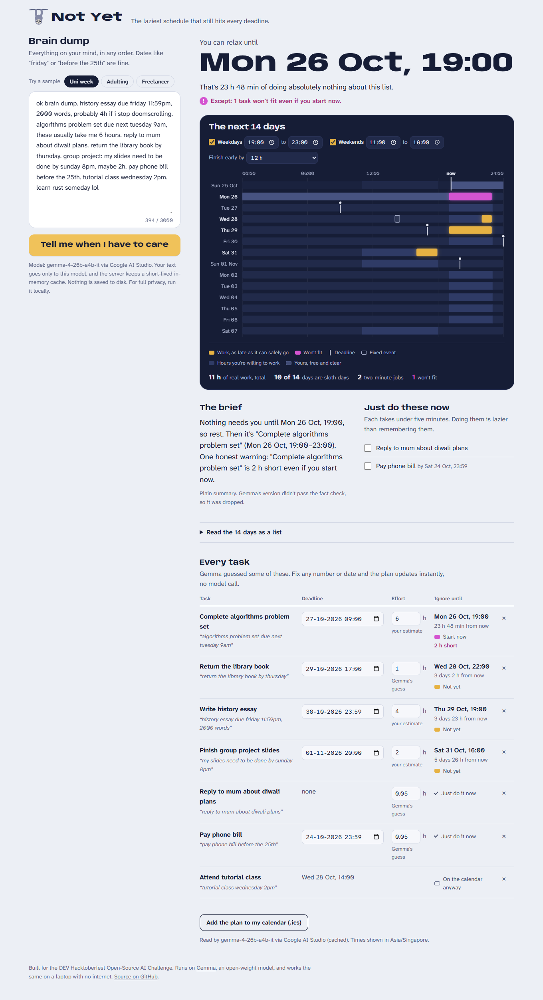
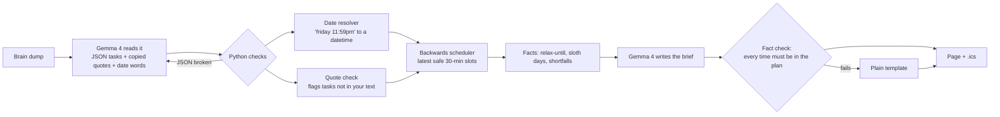

# Not Yet 🦥

**The laziest schedule that still hits every deadline.**

Paste the to-do brain dump that's been living in your head. Not Yet reads it with Gemma 4, an open-weight model, works out what each thing needs, and schedules every task as late as it can safely go inside the hours you're actually willing to work. Then it tells you the one thing you wanted to know: how long you can do nothing.



- **Relax-until time.** The first moment any task needs you, and how long that is from now.
- **Sloth days.** Days in the next two weeks with nothing scheduled at all.
- **Two-minute jobs** go in a "just do these now" list, because doing them is lazier than remembering them.
- **Honest warnings.** If something won't fit even if you start now, it says so and by how many hours.
- **One click to your calendar** (.ics), and every number and date is editable, with an instant re-plan and no model call.
- **The next 14 days on one chart.** Work lights up only in the hours you're willing to work, and the stretch you're free is shaded in. Change the margin or an estimate and the blocks slide to their new times.

**Live demo:** https://not-yet.onrender.com (free tier, so the first load can take up to a minute while it wakes up)

## How it works



**1. Gemma reads, Python checks** ([`notyet/extract.py`](notyet/extract.py)). Gemma turns the brain dump into JSON: title, kind (task or fixed event), effort in hours, tiny or not, one sitting or splittable. Each task also has to **copy the words it came from**. If that quote isn't in your text, the task is flagged in the UI instead of trusted. Broken JSON gets one repair round, with the parse error sent back to the model.

**2. Dates are maths, so code does them** ([`notyet/dates.py`](notyet/dates.py)). The small model read "friday" fine but sometimes put it on the wrong week. So Gemma also copies the date words ("next tuesday 9am", "before the 25th"), and a small resolver turns them into datetimes. When a phrase is outside what it understands ("in march", "eventually"), Gemma's own answer is kept.

**3. Scheduling backwards** ([`notyet/schedule.py`](notyet/schedule.py)). Working hours are cut into 30-minute slots. Starting with the task due last, each task takes the latest free slots that end before its deadline minus a safety margin (12 hours by default). If it only fits inside the margin it's marked tight. If it doesn't fit at all, it's marked short with the missing hours. Run backwards in time, this is the textbook "jobs with release dates on one machine" problem, where any schedule that never idles while work is waiting is optimal. So for tasks that can be split across sittings, whenever a valid plan exists, this greedy finds one. (One-sitting tasks use a best-effort search for a long enough free block.) [`tests/test_schedule.py`](tests/test_schedule.py) checks that against a brute-force capacity check on 300 random cases.

**4. The brief is fact-checked** ([`notyet/brief.py`](notyet/brief.py)). Gemma writes a three-sentence morning brief from facts the scheduler computed. If it mentions a time that isn't in the plan, or rambles, it's thrown away and a plain template is used instead. The UI says which one you're reading.

## Measured, not guessed

[`scripts/bench.py`](scripts/bench.py) runs extraction on the three sample brain dumps against labels I wrote by hand (22 tasks, 20 of them with an unambiguous deadline). Gemma 4 E4B (4-bit MLX) on a MacBook with an M5 chip and 16 GB RAM, 5 runs per sample, thinking off, fixed clock (Tue 20 Oct 2026 09:00 SGT):

| What | Result |
|---|---|
| Tasks found | 108 / 110 (both misses were "learn rust someday lol", which it read as a joke) |
| Deadlines right, Gemma's own calendar maths | 63 / 98 |
| Deadlines right, after `dates.py` | **98 / 98** |
| Two-minute jobs marked correctly | 93 / 93 |
| Quotes found in the original text | 108 / 108 |
| Time per brain dump | median 20.4 s (19.0 to 29.1 s) |

These are the same three samples I developed against, so read 98/98 as "no known failures", not as general accuracy. The first version of the resolver scored 92/100 on an earlier run. One miss repeated in every run (for "cancel the trial before it charges me on the 28th" the model copied only "the 28th"), so the resolver now looks back through the clause for a dropped "before", and the prompt asks the model to keep "by" and "before" when it copies.

Raw per-run numbers: [`docs/bench-results.json`](docs/bench-results.json). The labels are in the script, so you can disagree with them.

One more measurement from development: the same extraction with Gemma's thinking mode on took 65.5 s and 2,435 output tokens, against 18.5 s and 679 tokens with it off (one run each, same prompt). Accuracy didn't need the thinking, so it's off by default (`LLM_THINKING=on` brings it back).

## Run it

**Option A: hosted Gemma 4 (free Google AI Studio key)**
```bash
pip install -r requirements.txt
export GEMINI_API_KEY=...            # https://aistudio.google.com/apikey
uvicorn notyet.app:app --port 8000   # open http://localhost:8000
```

**Option B: fully offline on your own machine**
```bash
ollama pull gemma4:e4b                                # or: mlx_lm.server --model mlx-community/gemma-4-e4b-it-4bit
pip install -r requirements.txt
LLM_BASE_URL=http://localhost:11434/v1 LLM_MODEL=gemma4:e4b uvicorn notyet.app:app --port 8000
```
Any OpenAI-compatible server works (Ollama, mlx_lm.server, llama.cpp, LM Studio, vLLM). There's also a terminal version: `echo "essay due friday, 4h" | python -m notyet --ics plan.ics`.

**Tests:** `pip install pytest && pytest` (67 tests: scheduler, date resolver, extraction checks, brief fact check, iCalendar output, both model backends with mocked HTTP, and the API).

## Deploy on Render
The repo has a [`render.yaml`](render.yaml) blueprint. In Render: **New > Blueprint**, pick this repo, paste `GEMINI_API_KEY` when asked. It runs on the free plan. `GEMMA_MODEL` is a preference list (`gemma-4-26b-a4b-it,gemma-4-31b-it,gemma-3-27b-it`), so if a model is missing on the API the next one answers. `python scripts/check_gemini.py` shows which models your key can see and plans one sample end to end.

## Project layout
```
notyet/
  extract.py   brain dump -> checked tasks (prompt, JSON repair, quote grounding)
  dates.py     "friday 11:59pm" -> datetime
  schedule.py  backwards scheduler
  brief.py     model-written brief + fact check + template fallback
  core.py      glue + labels + .ics events
  llm.py       Gemini API and OpenAI-compatible backends
  app.py       FastAPI app (/api/plan, /api/reschedule)
  static/      one page and a hand-written SVG chart, no framework
scripts/       bench.py, screenshots.py
tests/
```

## Privacy
Your text goes to the model you configure and nowhere else. The server keeps an in-memory cache of the last 256 extractions so repeat clicks don't spend API quota. Nothing is written to disk and there are no accounts.

## Credits
- [Gemma 4](https://ai.google.dev/gemma) by Google DeepMind, used under the Gemma Terms of Use. Local runs used the [mlx-community/gemma-4-e4b-it-4bit](https://huggingface.co/mlx-community/gemma-4-e4b-it-4bit) conversion with [MLX LM](https://github.com/ml-explore/mlx-lm).
- [FastAPI](https://fastapi.tiangolo.com/), [httpx](https://www.python-httpx.org/), and the [Anybody](https://fonts.google.com/specimen/Anybody) and [Atkinson Hyperlegible Next](https://fonts.google.com/specimen/Atkinson+Hyperlegible+Next) fonts (SIL Open Font License).
- Built with [Claude Code](https://claude.com/claude-code) as a coding agent. The app itself runs only on Gemma.

## Licence
MIT. See [LICENSE](LICENSE).

Built for the [DEV Hacktoberfest Open-Source AI Challenge, Week 3: Slow and Steady](https://dev.to/challenges/hacktoberfest-week3-2026-10-19). Any commits after 25 Oct 2026 23:59 PDT will be listed here.
